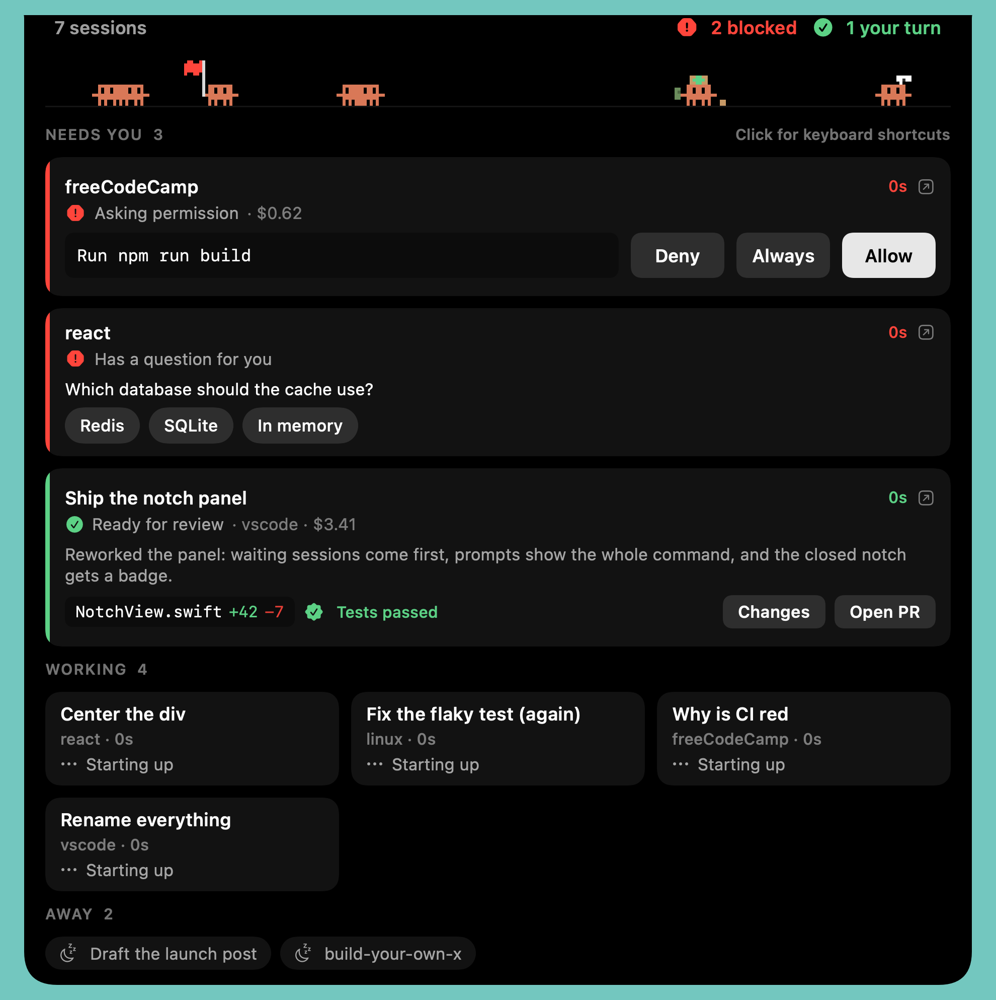
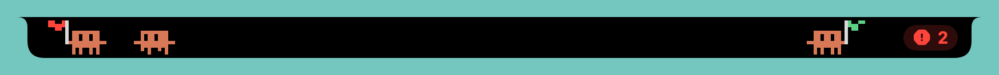
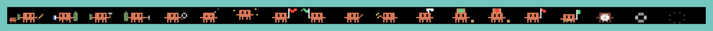
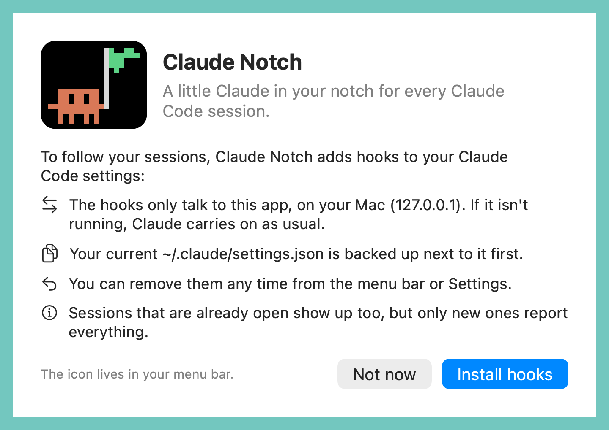
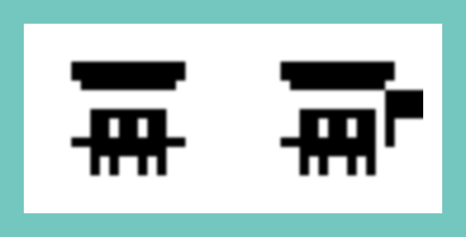

# Claude Notch

**Your Claude Code and Codex sessions, living in your Mac's notch.** Every running session gets a little pixel Claude that walks along the notch and shows what it's doing. When one needs you, it stops and waves a flag. Hover the notch and you can answer permission prompts, pick answers to Claude's questions, review what changed, and jump straight to the session.





## What it does

**See every session at a glance**
- One Claude per running Claude Code session: in the terminal, in the Claude app, or from the Agent SDK. Codex sessions show up too, as teal cousins.
- **Red flag:** blocked on a permission prompt or a question. **Green pennant:** finished, your turn. A badge on the closed notch counts who's waiting.
- Each Claude carries a prop for what it's doing: a pencil while editing, a book while reading, a hammer while running commands, a magnifying glass on the web. Sub-agents trail along as tiny Claudes.
- Each card shows the conversation's name, folder, running time, cost at API prices, and how full the context window is.

**Answer without switching windows**
- Permission prompts show the whole command, with **Deny**, **Always** and **Allow**. Always saves Claude Code's suggested rule, so it stops asking.
- Claude's multiple-choice questions show their options as buttons.
- **Deny with a reason:** the note button beside Deny lets you tell Claude why, so it changes course instead of stopping.
- If you don't answer, Claude asks in its own window as usual: after 20 s for prompts, 60 s for questions.

**Review what happened**
- A finished turn shows Claude's last message, each file it changed with `+added −removed`, and whether the tests passed.
- **Changes** opens a small diff. **Open PR** opens GitHub's pull request page for the branch.
- Hover any session for a timeline of its recent steps. Timelines and reviews survive restarts.

**Keep it tidy**
- Sessions idle for 15 minutes (you can change this) tuck themselves away so they stop holding the notch open. New activity brings them back.
- Sessions whose process dies vanish in a puff of smoke.
- Click a card, or press **⌃⌥J** from anywhere, to jump to a session: the exact tab in Terminal, iTerm or Ghostty, the pane in WezTerm, kitty or tmux, the session in the Claude app, or the folder's window in VS Code, Cursor, Windsurf or Zed.

**Stays out of the menu bar's way**
- The wings shrink to the free space beside the notch, so they never cover a menu bar icon (and, with Accessibility, never an app's menus). A side with no room is left out, or keep everyone on one side.
- Point at a wing, or open any menu, and it turns see-through. Clicks always go through to what's underneath.
- Only the notch itself opens the panel: hover it, push the pointer into the top edge, click it, or hover with ⌥ held.
- Prefer a clear menu bar? **Compact** shows just a badge; **Under the menu bar** moves the Claudes to a strip below it.
- **⌃⌥H** hides the notch for 10 minutes. Settings → Notch & Menu Bar can also tighten menu bar icon spacing so fewer hide behind the notch.

**Away from the desk, and on budget**
- **Phone alerts** through [ntfy](https://ntfy.sh): when a session has been blocked for a few minutes and you're away from the Mac, your phone hears about it. Opt-in, and it never sends the command.
- **Budgets:** get warned when a session, or everything running, costs more than you set.

**And it's a little bit alive**



High-fives when two Claudes meet. A backpack once the context passes 40%. A box on the head for each file changed, then a parcel with a green or red bow for the test result. Stickers for tools you've marked Always. A "?" bubble while a question waits. Flags that droop the longer you leave them. Bring the pointer up to the notch and nearby Claudes turn to look, with name tags underneath. Claudes never walk behind the notch.

## Install

Needs macOS 15 (Sequoia) or later, on Apple silicon or Intel.

1. Download the latest `Claude-Notch-<version>.zip` from [Releases](../../releases) and unzip it.
2. Drag **Claude Notch** into Applications and open it.
3. macOS blocks the first open because the app isn't notarized. Go to **System Settings → Privacy & Security**, scroll down, and click **Open Anyway**. (Or run `xattr -dr com.apple.quarantine "/Applications/Claude Notch.app"` once.)
4. In the welcome window, click **Install hooks**.



The icon lives in your menu bar: . Hover the notch to open the panel.

**Updating:** quit the app, replace it in Applications, open it, and if the menu says **Update Claude Code hooks**, click it.

**Without the UI** (over SSH, or in a setup script):

```bash
"/Applications/Claude Notch.app/Contents/MacOS/Claude Notch" --install-hooks
```

**Codex:** install its hooks from Settings (or with `--install-codex-hooks`), then type `/hooks` in Codex and trust them: Codex runs new hooks only after you approve them. Codex sessions support Allow and Deny; Always and question answers are Claude Code only.

**Cursor, VS Code and Windsurf terminals:** in Settings → Editor terminals, click **Set up terminal focus** (or run the app with `--install-editor-helper`). It installs a tiny companion extension ([source](integrations/terminal-focus/extension/extension.js)) that answers only Claude Notch's jump links, and pre-approves those links in the editor's settings, so jumping to a session lands in its exact integrated terminal with the keyboard ready.

**Terminals:** kitty needs `allow_remote_control yes` and `listen_on unix:/tmp/kitty` in `kitty.conf` for jumping to a tab. Ghostty matches tabs by terminal from builds newer than 1.3.1. Warp and Alacritty can only be brought to the front.

## Using it

| Do this | To |
|---|---|
| Hover the notch | Open the panel |
| Click a card | Jump to that session |
| Click the panel once, then **↑↓** (or **J/K**) | Select a session |
| **A**, **D**, **L** | Allow, deny, or always-allow the selected prompt |
| **Return** | Jump to the selected session |
| **X**, or × on a card | Tuck a session away until it does something new |
| **Z**, or the clock on a card | Snooze it: back in 10 minutes (or 30, or an hour) with a nudge |
| **S**, or ■ on a tile | Stop the turn (tmux and iTerm sessions) |
| **/** or **⌘F** | Search sessions by name, folder or activity |
| Right-click the notch | The app's menu, menu bar icon or not |
| **⌃⌥,** anywhere | Settings |
| **⌃⌥H** anywhere | Hide the notch for 10 minutes, or bring it back |
| **Esc** | Close the panel |
| **⌃⌥J** anywhere | Jump to whoever has waited longest |
| Drag a Claude in the open panel | Move it to the other side of the notch |

**Settings** open from the gear in the panel, a right-click on the notch, **⌃⌥,**, the menu bar icon, opening Claude Notch again from Applications or Spotlight, or `claude-notch://settings`. So the menu bar icon can be hidden, and Settings still work when macOS hides the icon behind the notch. There you'll find answering, notch style and menu bar fitting, which display to use, Quiet (and following Focus), budgets, phone alerts, **Rules**, terminal checks, the hooks, updates and **Copy diagnostics**. **Demo mode** in the menu fills the notch with pretend sessions.

**Rules** answer prompts before they reach you: allow `git status*`, deny `*rm -rf*`, always ask about `*.env*`. Every answer, yours or a rule's, goes to an audit log (`~/Library/Application Support/Claude Notch/audit.jsonl`).

**Reply and Stop:** sessions in tmux or iTerm get a reply field on their finished card (typed in as the next prompt) and a Stop button (Esc). Others jump to their window.

## Privacy

Everything stays on your Mac unless you turn on phone alerts or update checks, which send a short note (which session, and why it's waiting) to the ntfy topic you choose. The hooks post events to the app at `127.0.0.1`. The app reads Claude Code's own files under `~/.claude` (session transcripts and the list of running sessions) to show names, costs and context, and the Claude app's session list to jump to the right session. It sends nothing anywhere, and it never reads your login or API keys. Besides phone alerts, the only network requests are a once-a-day check of this repository's latest GitHub release (turn it off in Settings → About) and links you click, like **Open PR**. The header's plan usage comes from the Claude app's own cache file; the app never fetches it.

## Uninstall

Choose **Remove Claude Code hooks** in the menu (or run the app with `--uninstall-hooks`), quit it, and delete it from Applications. The first install saved your original settings as `~/.claude/settings.json.claude-notch-backup`.

## Build from source

Built with Xcode 26 (older versions may work) and [XcodeGen](https://github.com/yonaskolb/XcodeGen).

```bash
xcodegen generate
xcodebuild test -scheme ClaudeNotch -destination 'platform=macOS' -derivedDataPath build
open "build/Build/Products/Debug/Claude Notch.app"
```

**Releases:** push a tag like `v2.2` and GitHub Actions builds, packages and publishes it. The **Tests** workflow runs on every push. See [docs/RELEASING.md](docs/RELEASING.md), including how to turn on Developer ID signing and notarization.

## How it works

- **Hooks:** one command hook per Claude Code event posts the event's JSON to a tiny HTTP server in the app (`HookServer`, `127.0.0.1`, port 47474 or the next free one, written to `~/.claude/claude-notch-port` for the hooks to read). The server restarts itself after sleep or a failure, and installing hooks never overwrites an edit Claude Code makes at the same moment. Each hook gives up after a second and always succeeds, so Claude never waits on the app or breaks without it. The exception is the `PermissionRequest` hook: it waits briefly for an answer from the card and prints it as the hook's decision, or prints nothing so Claude asks as usual.
- **Sessions:** besides hooks, the app reads Claude Code's list of running sessions (`~/.claude/sessions/<pid>.json`) every 3 s. That finds sessions started before the hooks were installed, with their name and whether they're busy or idle. A session whose process dies is removed within 3 s.
- **Usage:** `UsageReader` reads only what's been added to each session's transcript since last time. It counts each API response once and prices the tokens at the model's list price. Codex transcripts give context use but no price.
- **History:** each session's timeline and review are saved to `~/Library/Application Support/Claude Notch/sessions/` and restored when it reappears; files unseen for two weeks are removed.
- **Battery:** the stage draws only as fast as it needs to: 15 fps while Claudes walk, slower for flags, almost never when everyone is still, and not at all while the screen is locked or asleep.
- **Characters:** `Stage` is a pure, heavily tested simulation (walking, resting, collisions, greetings, hops), drawn as pixel art by `Sprite` into a SwiftUI `Canvas`. With Reduce Motion on, they stand still.
- **Window:** a borderless, non-activating panel above the menu bar on every Space (`NotchPanel`). It lets clicks through while closed and only takes the keyboard after you click it. `MenuBarSpace` reads where status icons sit from the window list (no permission needed) and `WingFit` sizes each wing to the gap. Without a notch (an external display, or the lid closed), it draws one as tall as the menu bar.

What's next is in [docs/V2-PLAN.md](docs/V2-PLAN.md).

## A note on the character

The pixel Claude is inspired by Anthropic's Claude Code mascot, and "Claude" is Anthropic's name. That's fine among friends. Swap in an original character and name before distributing it widely.
