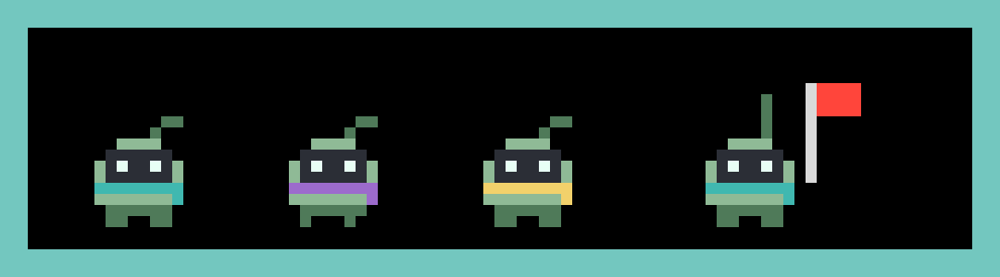

# A new name and character (V3 spike S1)

"Claude Notch" can't go wide: **ClaudeNotch** and **NotchClaude** already exist as other apps, "Claude" is Anthropic's name, and the pixel character is Anthropic's mascot. This is the shortlist. **The decision is yours.**

## Ruled out (already taken in this space or nearby)

Notchling (two separate notch-agent apps), Notchkin (a notch notes app), Nisse, Atoll, Warren, Burrow, Lintel, Islet, Crew Tower, Pitcrew, Bosun, Scamper (a Homebrew formula), Skerry, Pipkin, Smidge, Tomte, Moppet, plus the known notch-agent apps (Vibe Island, Open Island, Notchi, AgentPeek, Glint, Notchy, Coucou…).

## Shortlist

| | Name | Why | Availability (checked 2026-10-16) |
|---|---|---|---|
| **1** | **Hobkin** | A *hob* is the folklore house spirit that does chores while you're away, which is what an agent is. A hob is also the shelf by the fire, which the notch becomes. *-kin* means the little folk. Two syllables, easy to say, playful but credible. | GitHub: only a dormant 1-star repo. App Store: no results. Homebrew: free. `hobkin.dev`: likely free; `.com` and `.app` registered. No trademark found (not a formal search). |
| 2 | **Ledgekin** | "The little folk on the ledge." A coined word, so the easiest to own and search for. More descriptive, less punchy. | No GitHub, App Store or web hits. `ledgekin.com`, `.app` and `.dev` all look free. |
| 3 | **Pixfolk** | "Pixel folk": says what it is, and stretches to a critter per agent. | No exact hits, but "Pix-" is a crowded prefix (Pixar, Pixelmator). `.app` and `.dev` likely free. |

Before committing, run a proper trademark search (USPTO, EUIPO) and register the domain.

## Character sketch (for Hobkin)

- **Silhouette:** a rounded teardrop body with a dark face window and two bright eyes, plus one tall bent ear tuft that reads at notch size. The tuft stands up when it needs you, flops while it works, and droops while it waits.
- **Palette:** moss-sage body (#8FB996) with a fern shade (#4F7A5A), a charcoal face (#2B2D35), and mint eyes (#E8FFF4). Nothing like Anthropic's orange.
- **One accent per agent,** worn as a scarf: teal for Claude Code, plum for Codex, butter for whatever comes next. No vendor marks.
- **Personality:** an earnest, slightly fussy little worker. It hums along the ledge with its prop, taps a foot and grows a cobweb when left waiting, takes a proud bow over a finished parcel, and raises its flag like a hand in class when it needs permission.

All the existing behaviour (props, flags, parcels, puffs, high-fives) carries over: the stage is sprite-agnostic, so the swap is a new `Sprite` plus colours.

## When you've picked

Renaming touches the app name, bundle ID, repo name, README, release names and the hooks backup file name. It's one focused change; existing installs keep working as long as the hook URL (127.0.0.1:47474) stays the same.
